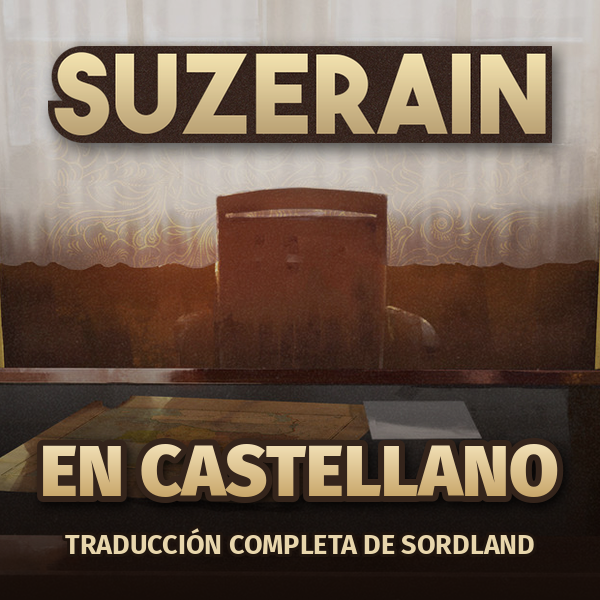

<p align="center"></p>

# Suzerain en castellano

Traducción no oficial al castellano de España de **Suzerain** (Torpor Games), hecha conversación a conversación y con el contexto de cada escena.

### ⬇️ [Descargar la versión 1.0](https://github.com/SuperPadLand/suzerain-castellano/releases/latest/download/Suzerain-en-castellano-1.0.zip)

## Qué está traducido

- La historia completa de **Sordland** (Anton Rayne): prólogo, los 11 turnos, los epílogos y todos los finales.
- Interfaz, menús, noticias, informes, diario, decisiones, decretos, leyes, políticas, situaciones, mapa, fichas de los personajes y el códex entero.
- El DLC **Kingdom of Rizia no está incluido**: sigue en inglés.

## Requisitos

- Suzerain de Steam en **Linux** (con Proton), versión 3.1.0. También vale en Steam Deck (modo escritorio, desde Konsole).
- Python 3.8 o más nuevo. En Debian, Ubuntu y Mint hace falta además `python3-venv` (`sudo apt install python3-venv`).
- Internet la primera vez: el instalador descarga UnityPy (unos 30 MB) en `~/.local/share/suzerain-castellano`. No toca nada más del sistema ni necesita `sudo`.

## Instalar

1. Cierra el juego.
2. Descomprime el zip, abre una terminal dentro de la carpeta y ejecuta:

   ```bash
   bash instalar.sh
   ```

   Busca el juego solo en tus bibliotecas de Steam. Si no lo encuentra, pásale la carpeta:

   ```bash
   bash instalar.sh "/ruta/a/SteamLibrary/steamapps/common/Suzerain"
   ```

3. Abre Suzerain. Funciona también con partidas ya empezadas.

El parche no incluye archivos del juego: traduce los tuyos y guarda una copia de los originales en `~/.local/share/suzerain-castellano/originales`.

**Si Steam actualiza el juego** y vuelve el inglés, ejecuta otra vez `instalar.sh`. Lo que haya cambiado en la actualización se queda en inglés y el instalador lo avisa.

## Desinstalar

```bash
bash desinstalar.sh
```

O en Steam: Suzerain › Propiedades › Archivos instalados › Verificar integridad de los archivos del juego.

## Problemas

- **«No encuentro Suzerain»**: pásale la carpeta del juego (ver «Instalar»).
- **«Suzerain está abierto»**: cierra el juego del todo y repite.
- **«No se pudo crear el entorno de Python»**: instala `python3-venv`.
- **Muchos textos en inglés después de instalar**: puede que tengas otro mod o traducción puesta. Verifica los archivos en Steam y vuelve a instalar.
- El registro de la última instalación queda en `~/.local/share/suzerain-castellano/ultimo-registro.txt`.

De momento solo hay instalador para Linux.

---

Suzerain es © Torpor Games. Esta traducción no está afiliada a ellos.
